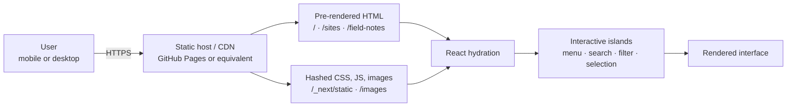
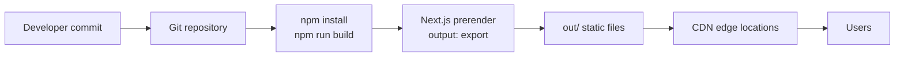
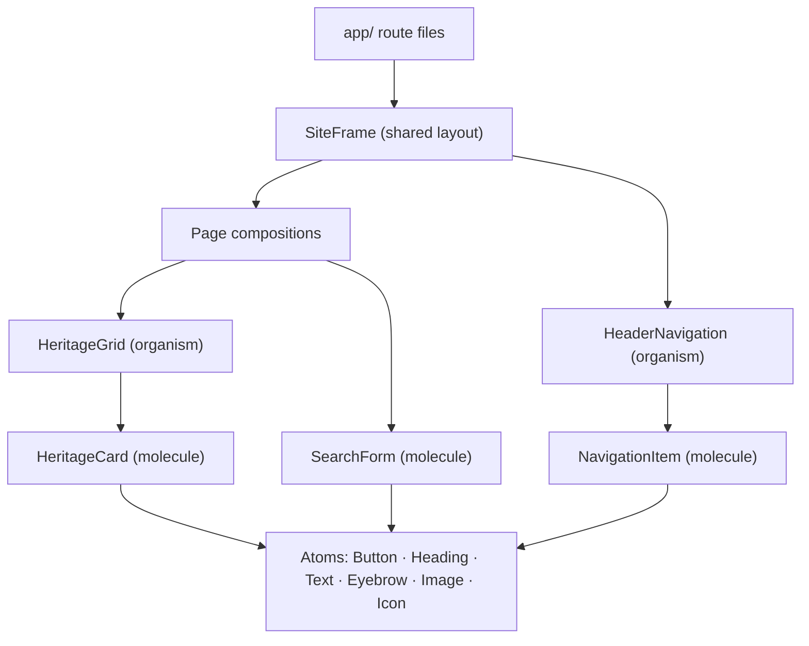

# Web Presenter Guide — Pangasinan Heritage Digital Showcase

**Subject:** Elective 4 (Special Topics in IT)
**Requirement:** Comprehensive Capstone Group Presentation
**Instructor:** Rey Molano
**Your scope:** the web application in this repository — overview, demo, framework, architecture, JAMstack, performance, challenges, and conclusions.
**Not your scope:** the mobile application, which is your teammate's section.

> Rehearse from `SPEAKER-SCRIPT.md`. Use this guide to understand the reasoning, the numbers, and the likely questions.
>
> If your teammate needs material for the mobile section, give them `MOBILE-TEAMMATE-BRIEF.md`.

---

## 1. Your scope and the group split

You are presenting **the web build only**. That is a legitimate split: the rubric asks each member to own a topic, and the mobile framework/architecture is a separate 20% section. Your job is to make the web half technically strong and to hand off cleanly.

A practical 25-minute group structure:

| Section | Owner | Time |
|---|---|---:|
| Title, agenda, project overview, features | You | 2:45 |
| Live web demo | You | 2:30 |
| Web framework + alternatives | You | 2:00 |
| Web architecture + component organization | You | 3:30 |
| JAMstack + performance techniques | You | 2:15 |
| Lighthouse metrics + issues/fixes | You | 2:00 |
| Web challenges + conclusions + handoff | You | 1:45 |
| **Your web section total** | **You** | **~17:00** |
| Mobile framework + architecture + progress | Teammate | ~6:30 |
| Q&A / buffer | Group | ~1:30 |

If your group has two web presenters, split at **7:30**: Presenter 1 takes overview → alternatives; Presenter 2 takes architecture → handoff. The script includes both paths.

**Do not present the mobile work as yours.** Say "my teammate will cover the mobile architecture" at the handoff. That is cleaner and protects individual participation grading.

> **Module 2 note:** only the Lesson 1 PDF was provided with this request, so the mapping below is to Lesson 1. Add one line in your conclusions naming the specific Module 2 topics your instructor covered. Do not claim a concept you cannot explain.

---

## 2. What the grader is scoring

| Rubric criterion | Weight | Your coverage | What they must hear |
|---|---:|---|---|
| Project overview and system demonstration | 15% | Slides 3–7 | A real problem, real users, a working web demo, honest scope |
| Web architecture and framework justification | 20% | Slides 8–11 | Why Next.js/React/TypeScript/Tailwind; component organization; data flow |
| Web performance architecture and metrics | 15% | Slides 12–16 | JAMstack mapping, build/deploy flow, caching/lazy loading, **real** Lighthouse numbers, issues and fixes |
| Mobile framework and architecture | 20% | Teammate | Not your section; hand off clearly |
| Technical understanding and justification | 15% | Q&A | You can explain trade-offs, not just names |
| Presentation quality and individual participation | 10% | Whole video | Every member speaks, introduces themselves, camera on, clear delivery |
| Compliance with instructions and submission | 5% | Checklist | Title slide, names, 25-minute limit, MP4/slides, file naming |

**The sentence that ties your whole section together:**

> "We chose a static, pre-rendered Next.js architecture because the content is curated and read-heavy. That gives us CDN delivery, low cost, a small attack surface, and measured accessibility/SEO scores of 100, while keeping a clean path to an API and a mobile client later."

That connects the business context, the framework choice, the architecture, the performance model, and the teammate's mobile roadmap.

---

## 3. Slide-by-slide content

Keep slides visual. Put the claim on the slide; say the explanation.

### Slide 1 — Title

**On screen**
- Pangasinan Heritage Digital Platform
- Pangasinan Heritage Digital Showcase (current web build)
- Group `[NUMBER]` — `[all member names]`
- Elective 4 (Special Topics in IT) — Sir Rey Molano
- Date

**Purpose:** satisfy the title-slide requirement immediately. Every complete name must be visible.

### Slide 2 — Agenda

**On screen:** Overview & Demo · Web Framework · Web Architecture · JAMstack & Metrics · Challenges · Handoff to Mobile.

**Purpose:** show structure and signal that the presentation follows the required outline.

### Slide 3 — Project overview and business context

**On screen**
- Problem: heritage information is scattered, image-heavy, and inconsistent on mobile.
- Vision: one lightweight field guide with curated records (place, category, location, context, photo).
- Users: domestic tourists, students/researchers, local tourism offices.
- Scope: 3 records — Hundred Islands (coastal), Bolinao Lighthouse (built), Balungao Hot Spring (natural wellness).
- Constraints: small team, academic timeline, no server budget, low-bandwidth users.

**Purpose:** prove this is a product decision, not a coding exercise. The three records are a deliberate vertical slice, not a lack of content.

### Slide 4 — Features and constraints

**On screen:** route map + feature list.
- `/` Home — purpose + featured record
- `/sites` Sites — search, category filter, live count, empty state, selected record
- `/field-notes` Field notes — one record at a time
- Responsive nav, skip link, keyboard focus, `aria-live`, `aria-pressed`, reduced motion
- Constraints: no backend, no database, low-data users, academic timeline

**Purpose:** demonstrate scope and set up the architecture section. The accessibility list is evidence, not decoration.

### Slides 5–7 — Demonstration

**Demo path (rehearse it exactly):**
1. Home: point at the hero, the featured record, and the two calls to action.
2. Click **Browse heritage sites**.
3. Type `bolinao`; show `1 of 3`; clear it.
4. Choose category **Natural wellness**; show only Balungao; clear it.
5. Click **Open record** on a card; show the selected-record panel.
6. Click **Field notes**; switch between records; point out the pressed state.
7. Resize to ~375px; open the mobile menu; close it.

**Purpose:** the rubric asks for available features and navigation flow. A live demo is stronger than screenshots, but have a recorded backup.

**Demo safety:** run `npm run dev` before recording; keep `http://localhost:3000` open; use 100% browser zoom; close notifications; have screenshots ready.

### Slide 8 — Web framework selection

**On screen:** Next.js 14 · React 18 · TypeScript 5.5 · Tailwind 3.4 · static export.

**Four justification columns**
| Criterion | Evidence in this project |
|---|---|
| Maintainability | File-based routing; six-line route files; typed props; one Tailwind config; one data source |
| Scalability | Static `out/` folder; CDN-ready; component layers; add pages without rewriting the shell |
| Performance | Pre-rendered HTML; per-route code splitting; hashed assets; 90–93 kB first-load JS |
| Development efficiency | One language (TypeScript); reusable atoms/molecules; fast dev server; `npm run typecheck` |

**Purpose:** answer "why this framework" with criteria, not popularity. Mention `output: "export"` in `next.config.mjs` as the key decision.

### Slide 9 — Alternatives and trade-offs

**On screen:** a small comparison.

| Option | Why not chosen |
|---|---|
| Vue + Nuxt | Gentler curve, but team already knew React; React Native path for mobile |
| React + Vite | Lighter, but routing, metadata, and pre-rendering would be rebuilt manually |
| WordPress | Fast start, but database/plugin/hosting overhead and less design-system control |

**Also state the cost of the chosen path:** static export means no Next API routes, no server sessions. Accounts/favorites/user content would require a separate API or serverless functions.

**Purpose:** technical maturity. A choice without a trade-off sounds like a preference.

### Slide 10 — Web architecture

**On screen:** the runtime diagram (Section 5) + folder tree.

**Say the responsibilities in one breath:**
- `app/` — routes and metadata
- `components/layout/SiteFrame.tsx` — shared header/main/footer shell
- `components/atoms/` — Button, Heading, Text, Eyebrow, Image, Icon, tokens
- `components/molecules/` — HeritageCard, SearchForm, NavigationItem
- `components/organisms/` — HeaderNavigation, HeritageGrid
- `components/pages/` — route compositions
- `lib/heritage.ts` — `HeritageSite` type + three records

**Client/server boundary:** only `HeaderNavigation`, `SitesExplorer`, and `FieldNotesPage` use `"use client"` because they own state. Everything else is server-rendered by default.

**Purpose:** the rubric explicitly asks for major components and their responsibilities. This slide is 20% of the grade, so do not rush it.

### Slide 11 — Component organization and data flow

**On screen:** folder tree + two short code excerpts:
- `app/sites/page.tsx` (six lines: `SiteFrame` + `SitesExplorer`)
- `SitesExplorer.tsx` `useMemo` filter block

**Say:**
- Dependency direction is one-way: pages → organisms → molecules → atoms.
- Atoms never import pages; that prevents circular dependencies.
- `HeritageCard` receives `site` and `onViewMore`; it does not fetch or know the route.
- `SearchForm` is controlled by its parent through `query`, `filter`, and callbacks.
- State flows down; events flow up; no global store because the scope does not need one.
- Adding a site = one object; changing all cards = one molecule; adding a route = one six-line file + one composition.

**Purpose:** demonstrate reusability with actual code.

### Slide 12 — JAMstack architecture

**On screen:** the build/deploy diagram (Section 5) + a three-column mapping.

| JAMstack pillar | This project |
|---|---|
| **Markup** | Pre-rendered HTML at build time via Next.js `output: "export"` |
| **JavaScript** | React hydration only for menu, search, filter, selection |
| **APIs** | None at runtime in v1; content compiled from `lib/heritage.ts`; boundary ready for a future API |

**Say:** Git-based workflow (commit → build → deploy), decoupling (UI/content separate from hosting), CDN distribution (static files at the edge), pre-rendering (no per-request server or database).

**Trade-offs:** build time grows with content; frequent edits trigger rebuilds; dynamic features need an API/serverless function.

### Slide 13 — Performance techniques already implemented

**On screen:** a checklist with file references.
- Route-level code splitting — Next.js build output: 90.5 kB `/`, 92.4 kB `/field-notes`, 92.7 kB `/sites` first-load JS.
- Content-hashed static assets — long-lived caching by the host/CDN.
- Native lazy loading + `decoding="async"` — `components/atoms/Image.tsx`.
- Explicit `width`/`height` and aspect ratios — CLS 0.
- Local images, no third-party image API — fewer connections.
- Inline SVG icons — `components/atoms/Icon.tsx`; no icon package.
- System font stacks — no font download, no font-swap shift.
- Mobile-first CSS + reduced-motion support — `app/globals.css`.

**Planned:** WebP/AVIF + `srcset`, hero preload, favicon, label fix, production compression/cache headers.

### Slides 14–15 — Measured performance

**On screen:** the results table below, plus one line: "Lighthouse 12, production build, headless Chrome, local static server."

| Route / device | Performance | Accessibility | Best practices | SEO | FCP | LCP | TBT | CLS |
|---|---:|---:|---:|---:|---:|---:|---:|---:|
| `/` mobile | **88** | **100** | **96** | **100** | 0.9 s | 3.6 s | 180 ms | 0 |
| `/` desktop | **100** | **100** | **96** | **100** | 0.3 s | 0.7 s | 0 ms | 0 |
| `/sites` mobile | **85** | **100** | **96** | **100** | 0.9 s | 4.4 s | 10 ms | 0 |
| `/field-notes` mobile | **92** | **100** | **96** | **100** | 0.9 s | 3.4 s | 10 ms | 0 |

**Caveat to say out loud:** the local static server did not enable gzip/Brotli or long-lived cache headers, so Lighthouse penalized text compression and caching. Re-run on the deployed URL and replace this table with that report. Do not mix test setups in one table.

**How to reproduce (write this in your notes):**
```powershell
npm run build
npx serve@14 out -l 3000
# in a second terminal:
npx lighthouse http://localhost:3000 --view
npx lighthouse http://localhost:3000 --preset=desktop --view
```

### Slide 16 — Issues found and fixes

**On screen:** four rows — issue, evidence, fix, status.

| Issue | Evidence | Fix | Status |
|---|---|---|---|
| Mobile LCP above 2.5 s | LCP 3.4–4.4 s; LCP element is the hero JPEG; 66% render delay on Home | WebP/AVIF + `srcset`, preload hero, reduce main-thread work | Planned |
| Best practices 96 | `favicon.ico` 404 | Add `app/icon.png` or `public/favicon.ico` | Planned |
| Logo label mismatch | `aria-label` does not include all visible text | Align the label with the visible text | Planned |
| Unused JavaScript | ~123 kB on Home | Audit imports; keep interactive islands small | Planned |
| Image delivery | ~84 kB modern-format savings; ~186 kB responsive-image savings | Next-gen formats + correct sizes | Planned |

**Already implemented:** image compression, lazy loading, explicit dimensions, route-level code splitting, inline icons, system fonts.

**Purpose:** the rubric asks you to identify issues and explain improvements already implemented or planned. Reporting a real 88 is stronger than claiming 100.

### Slide 17 — Challenges experienced

**On screen:** three challenge → solution → lesson rows.
1. Static export vs dynamic search → client-side data + `useMemo`; limit: not for thousands of records.
2. Asymmetric responsive grid → 12-column grid + explicit spans; mobile-first base.
3. Image/LCP performance → compression, dimensions, lazy loading; next: WebP/srcset.

**Unresolved row:** favicon, logo label, unused `components/showcase/ShowcasePage.tsx`.

**Purpose:** the rubric asks for challenges, solutions, and unresolved issues. Naming an unused prototype is a credibility signal, not a weakness.

### Slide 18 — Conclusions

**On screen:** three boxes.
- **Architecture:** component-first, Atomic Design, one data source.
- **Delivery:** JAMstack, pre-rendered, static, CDN-ready, no runtime server.
- **Evidence:** accessibility/SEO 100, desktop performance 100, mobile 85–92, CLS 0.

**Say:** Module 1 supplied the criteria: responsive/component architecture, framework selection, JAMstack/BFF/edge, Core Web Vitals. The project applies them rather than merely naming them.

### Slide 19 — Handoff to mobile

**On screen:** "Web section complete → Mobile framework and architecture: `[Teammate Name]`."

**Say:** "That covers the web build and its architecture. My name is `[YOUR FULL NAME]`, and I will hand over to `[MOBILE TEAMMATE FULL NAME]` for the mobile framework and architecture."

**Purpose:** clear individual participation, clean section boundary, and a professional transition.

---

## 4. Diagrams to paste into your slides

Render at [mermaid.live](https://mermaid.live) and export PNG/SVG, or redraw in PowerPoint.

### 4.1 Runtime architecture



**What to say:** no application server, no database, no per-request render; the HTML and assets are built ahead of time and served from the edge.

### 4.2 Build and deployment pipeline



**What to say:** the Git-based workflow is part of JAMstack; the deploy artifact is a folder of static files, not a running server.

### 4.3 Component hierarchy



**What to say:** dependency direction is one-way; atoms are the vocabulary, molecules combine atoms for one job, organisms form complete regions, pages assemble regions for a route.

### 4.4 Plain-text fallback

```
Browser
  │ HTTPS
  ▼
Static host / CDN
  ├── pre-rendered HTML (/, /sites, /field-notes)
  └── hashed CSS + JS + local images
          │
          ▼
   React hydration
          │
          ▼
Interactive islands: menu, search, filter, record selection
```

---

## 5. Performance numbers you can defend

Real measurements from this repository's production build, not estimates.

**Test setup:** `npm run build` succeeded; the `out/` folder was served by a minimal local Node static server; Lighthouse 12 ran in headless Chrome. Mobile is Lighthouse's default mobile emulation (throttled CPU/network); desktop used the desktop preset.

| Route / device | Perf | A11y | Best practices | SEO | FCP | LCP | TBT | CLS |
|---|---:|---:|---:|---:|---:|---:|---:|---:|
| Home, mobile | 88 | 100 | 96 | 100 | 0.9 s | 3.6 s | 180 ms | 0 |
| Home, desktop | 100 | 100 | 96 | 100 | 0.3 s | 0.7 s | 0 ms | 0 |
| Sites, mobile | 85 | 100 | 96 | 100 | 0.9 s | 4.4 s | 10 ms | 0 |
| Field notes, mobile | 92 | 100 | 96 | 100 | 0.9 s | 3.4 s | 10 ms | 0 |

**Build output:** first-load JavaScript 90.5 kB (`/`), 92.4 kB (`/field-notes`), 92.7 kB (`/sites`); shared JS 87.3 kB.

**What the numbers mean**
- **Accessibility 100** on every route: semantic headings, labels, skip link, focus styles, `aria-live`, `aria-pressed`, `aria-expanded`, reduced motion.
- **SEO 100**: title/description metadata, semantic structure, crawlable links, `lang="en"`.
- **CLS 0**: explicit image dimensions/aspect ratios, system fonts, no late-injected content.
- **Desktop performance 100**: small bundles and a fast image load on a non-throttled profile.
- **Mobile performance 85–92**: the remaining gap is LCP. The hero JPEG is the LCP element, and most of the LCP time is render delay, not download.

**Important caveat:** the local server used for this audit did not enable gzip/Brotli or long-lived cache headers. Lighthouse therefore flagged `uses-text-compression` and caching. A production static host or CDN should improve those audits. **Do not claim those improved numbers until you measure the deployed URL.** If you re-run with `serve` or GitHub Pages and get different scores, replace the table and state the setup.

**INP note:** Lighthouse lab data reports **TBT** as a proxy for responsiveness, not INP. INP needs field data (for example, Chrome UX Report or real-user monitoring). If asked, say: "Our lab TBT is 180 ms on Home and 10 ms on the other routes; we have not measured field INP yet."

---

## 6. Q&A bank (web questions)

Answer in 2–4 sentences. Do not over-explain.

**1. Why did you choose Next.js instead of plain React?**
Next gives file-based routing, a shared layout, metadata, code splitting, and pre-rendering out of the box. With plain React we would rebuild those conventions. We also use `output: "export"` to produce a static site, so there is no server to operate.

**2. Why not use `next/image`?**
The default Next image optimizer needs a server. With static export we chose a native `img` with explicit dimensions, lazy loading, and compressed local assets. The trade-off is that we manage `srcset` and next-gen formats ourselves; that is on our improvement list.

**3. Why is there no backend or database?**
The content is three curated records and changes rarely. Compiling it at build time removes per-request latency, hosting cost, and a large attack surface. When content becomes editable or user-generated, we will add an API or CMS behind the same component contracts.

**4. Is this really JAMstack if you have no API?**
Yes. JAMstack is markup, JavaScript, and APIs; the API pillar is absent by design in v1 because the data is compiled in. The important part is the boundary: the UI reads from a typed data module, so it can switch to an API without rewriting components.

**5. How would search scale beyond three records?**
Right now filtering is client-side and linear, which is fine for a small curated set. Beyond hundreds of records, we would move search to an API or a search index, add pagination, and avoid shipping the entire dataset to the client.

**6. What is a BFF?**
Backend for Frontend: a backend dedicated to one client. A mobile BFF would return only the fields the mobile screens need, centralize authentication, and aggregate other services. It is future work; we would add it when the mobile app needs auth or a tailored payload. My teammate can cover the mobile side.

**7. Where does edge computing fit?**
Today the CDN edge caches our static files, which is the main latency win. Edge functions would be useful later for authentication, personalization, A/B testing, or image transformation. Static export does not use Next middleware, so we would add edge logic at the host or in a separate service.

**8. Why React instead of Vue?**
Both are capable. The decision was team experience, ecosystem size, and a consistent component model. Vue with Nuxt would also have been a reasonable choice for a content site.

**9. Why Tailwind instead of CSS modules or styled-components?**
Tailwind keeps design tokens in one config, encourages mobile-first breakpoints, and removes unused CSS at build time. The trade-off is class-heavy markup. For a small team, the consistency benefit outweighed the verbosity.

**10. How is state managed?**
Local `useState` for query, filter, and selected record; `useMemo` for the derived filtered list. No Redux or global store because no state is shared across routes. We would add Context or a small store when favorites or auth arrive.

**11. How did you get accessibility 100?**
Semantic landmarks and headings, a skip link, labelled form controls, visible focus styles, `aria-live` for result counts, `aria-pressed` for the field-note selector, `aria-expanded`/`aria-controls` for the menu, meaningful alt text, and reduced-motion support. We also test keyboard navigation.

**12. Lighthouse still flags a label mismatch — how is accessibility 100?**
The category score is weighted; that audit is currently zero-weight in Lighthouse 12, so it does not lower the score. We still treat it as a real defect and will align the logo's `aria-label` with its visible text.

**13. Why is mobile performance lower than desktop?**
Lighthouse mobile emulation throttles CPU and network. The LCP element is the hero image, and most of the LCP time is render delay. Desktop is not throttled and scores 100. The fix is next-gen images, `srcset`, a hero preload, and less main-thread work.

**14. What is CLS, and why is yours zero?**
Cumulative Layout Shift measures unexpected visual movement. We reserve image space with width/height and aspect ratios, use system fonts so there is no font swap, and do not inject content above existing content.

**15. What would you do differently?**
Set a performance budget before building, add automated tests for the filter logic earlier, remove prototype code as soon as it is superseded, and define a content API contract before the collection grows.

**16. How do you deploy, and what about GitHub Pages?**
The build writes `out/`; any static host can serve it. `next.config.mjs` supports an environment-driven `basePath`/`assetPrefix` for a GitHub Pages project subpath. One caveat: plain `` is not automatically prefixed by `basePath`; if you deploy under `/repo-name/`, prefix image sources with the same base path or use a component that handles it. Verify the deployed URL, not just localhost.

**17. What is the difference between SSG, SSR, and ISR?**
SSG builds HTML ahead of time (what we use). SSR renders on each request. ISR rebuilds or revalidates pages in the background. Static export supports SSG; SSR/ISR need a running Next server or a host that supports them.

**18. What happens during hydration?**
The browser receives pre-rendered HTML, then React attaches event handlers and state to it. Our interactive islands are small: the menu, the Sites explorer, and the Field notes selector. Keeping them small reduces main-thread work and improves responsiveness.

**19. What are the security considerations?**
The web build is static: no server, no database, no secrets in the client. When we add auth, we will use HTTPS, an auth provider or BFF, server-side validation, and least-privilege access. We will not put API secrets in the client bundle.

**20. Why only three sites?**
It is a vertical slice: one record per category, enough to prove the architecture, search, filtering, and detail flow. The data layer is a typed array, so adding records is a content task, not a rewrite. The next step is expanding the collection and moving it behind a CMS/API.

**21. What did you personally do?**
Answer with concrete ownership. For example: design system and routes; data model and search/filter; performance testing and deployment. Adjust to the truth. Do not claim your teammate's mobile work.

---

## 7. Presenter split

### If you present the whole web section alone

| Time | Section |
|---|---|
| 0:00–0:45 | Title + agenda |
| 0:45–3:00 | Overview + features |
| 3:00–5:30 | Demo |
| 5:30–7:30 | Framework + alternatives |
| 7:30–10:00 | Web architecture |
| 10:00–11:00 | Components + data flow |
| 11:00–12:30 | JAMstack |
| 12:30–13:15 | Performance techniques |
| 13:15–14:30 | Metrics |
| 14:30–15:15 | Issues and fixes |
| 15:15–16:00 | Challenges |
| 16:00–16:45 | Conclusions |
| 16:45–17:00 | Handoff to mobile |

### If two of you present the web section

| Time | Presenter | Section |
|---|---|---|
| 0:00–5:30 | 1 | Title, overview, features, demo |
| 5:30–7:30 | 1 | Framework + alternatives |
| 7:30–11:00 | 2 | Web architecture, components, data flow |
| 11:00–15:15 | 2 | JAMstack, techniques, metrics, issues |
| 15:15–17:00 | 2 | Challenges, conclusions, handoff |

Each presenter must say their full name at the start of their part.

---

## 8. Recording and submission checklist

### Before recording
- [ ] Replace all placeholders in the title slide and script.
- [ ] Confirm the group number and the complete names of all members.
- [ ] Run `npm run build` and `npm run typecheck` successfully.
- [ ] Run `npm run dev` and test the full demo path.
- [ ] Prepare backup screenshots or a screen recording of the demo.
- [ ] Prepare the Lighthouse report (JSON/HTML) and keep it open.
- [ ] Close notifications, chat apps, and unrelated browser tabs.
- [ ] Use a quiet room, good lighting, and a clear microphone.
- [ ] Test the camera framing: face visible, screen share readable.
- [ ] Agree on the handoff line with your mobile teammate.

### During recording
- [ ] Every presenter's camera is on and face is visible.
- [ ] The current presenter introduces themselves by full name.
- [ ] Slides are readable at 1080p.
- [ ] The demo shows the actual current build.
- [ ] You do not claim the mobile work as yours.
- [ ] The group stays within 25 minutes; target 23:30.
- [ ] Do not read slides; explain the reasoning.

### Submission
- [ ] Video: MP4 or a Google Drive link with viewing access.
- [ ] Slides: PDF or PowerPoint.
- [ ] File names:
  - `GroupNumber_CapstoneTitle_MidtermPresentation.mp4`
  - `GroupNumber_CapstoneTitle_Slides.pdf`
- [ ] Only the group leader submits.
- [ ] One complete set per group.
- [ ] Verify the Drive link opens in an incognito window.
- [ ] Verify the video plays with audio before submitting.

---

## 9. Rehearsal plan

**Pass 1 — Accuracy (read the script once).**
Record yourself alone. Mark every sentence you stumble on. Replace formal wording with your own words, but keep the technical claims identical.

**Pass 2 — Timing (run the full web deck with a timer).**
Target 17:00 for the web section. If you exceed it, cut from the demo and the alternatives slide first, not from the architecture or performance sections. Those carry the most rubric weight.

**Pass 3 — Q&A (someone asks 10 web questions).**
Use the Q&A bank. Answer out loud, in 2–4 sentences, without reading. If you do not know, say: "We have not measured that yet; our plan is X." That is stronger than guessing.

**Pass 4 — Full group recording.**
Do one complete take with cameras, screen share, the demo, and the handoff to your teammate. Review audio, framing, readability, and time.

---

## 10. Optional code improvements (only if you have time)

These are real, small improvements that would strengthen the "already implemented" story. Do them one at a time, rebuild, and re-measure. Do not change the presentation numbers unless you re-run Lighthouse.

1. **Add a favicon.** Add `app/icon.png` using the contour mark, or `public/favicon.ico`. This should remove the `favicon.ico` 404 and improve Best Practices from 96 to 100.
2. **Fix the logo label.** In `components/organisms/HeaderNavigation.tsx`, change `aria-label="Pangasinan Heritage Digital Showcase home"` to a label that contains the visible text, for example `aria-label="Pangasinan Heritage field guide — home"`.
3. **Serve WebP/AVIF.** Convert the three JPEGs, update `imageSrc`, and use a `<picture>` element or `srcset` in `components/atoms/Image.tsx`. Lighthouse estimated ~84 kB savings from modern formats.
4. **Preload the hero.** Add `<link rel="preload" as="image" href="/images/hundred-islands-pangasinan.jpg" fetchPriority="high">` in `app/layout.tsx`, or add `fetchPriority="high"` to the priority image.
5. **Remove unused prototype code.** `components/showcase/ShowcasePage.tsx` is not imported by any route. Delete it or document it as a prototype; do not leave it unexplained.
6. **Add a test for filtering.** Extract the filter predicate from `SitesExplorer.tsx` into `lib/filterHeritage.ts` and test it with Vitest. This gives you a concrete answer to "do you have tests?"
7. **Check the GitHub Pages image path.** If deploying under `/repo-name/`, root-relative image sources need the same base path. Verify the deployed URL; localhost will not reveal this bug.
8. **Re-measure on the deployed URL.** Replace the local-server caveat with a deployed-host result, and keep the same Lighthouse version and device profile.

---

## 11. 60-second summary (memorize this)

> The Pangasinan Heritage Digital Showcase is a static Next.js 14 web app for three curated heritage records. It uses React, TypeScript, Tailwind, and Atomic Design. Each route is a thin composition over a shared frame; a typed data module is the single source of truth. The build is pre-rendered and exported to static files, so it is JAMstack: markup at build time, JavaScript only for interaction, no runtime server, CDN-ready. Measured Lighthouse: accessibility and SEO 100 on every route, desktop performance 100, mobile 85–92 with LCP as the remaining issue. The main lesson is that architecture is a series of explicit trade-offs, and we measured instead of guessed.

---

## 12. Quick file map for the Q&A

| If asked about... | Open this file |
|---|---|
| Static export / deployment | `next.config.mjs` |
| Routes / metadata | `app/layout.tsx`, `app/page.tsx`, `app/sites/page.tsx`, `app/field-notes/page.tsx` |
| Shared shell | `components/layout/SiteFrame.tsx` |
| Design tokens | `tailwind.config.ts`, `components/atoms/tokens.ts` |
| Reusable button | `components/atoms/Button.tsx` |
| Typography atoms | `components/atoms/Typography.tsx` |
| Lazy loading / image dimensions | `components/atoms/Image.tsx` |
| Inline icons | `components/atoms/Icon.tsx` |
| Card reuse | `components/molecules/HeritageCard.tsx` |
| Controlled search form | `components/molecules/SearchForm.tsx` |
| Navigation link | `components/molecules/NavigationItem.tsx` |
| Responsive grid / empty state | `components/organisms/HeritageGrid.tsx` |
| Mobile menu / ARIA | `components/organisms/HeaderNavigation.tsx` |
| Search/filter state + `useMemo` | `components/pages/SitesExplorer.tsx` |
| Field-note selection | `components/pages/FieldNotesPage.tsx` |
| Home composition | `components/pages/HomePage.tsx` |
| Data model and records | `lib/heritage.ts` |
| Global focus / reduced motion | `app/globals.css` |
